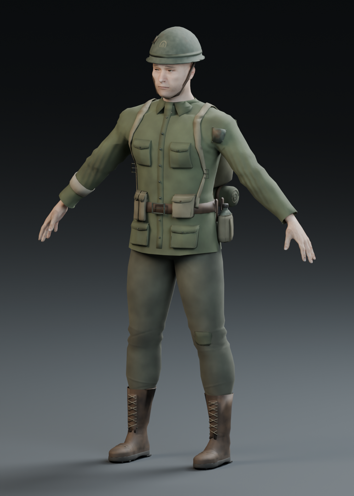
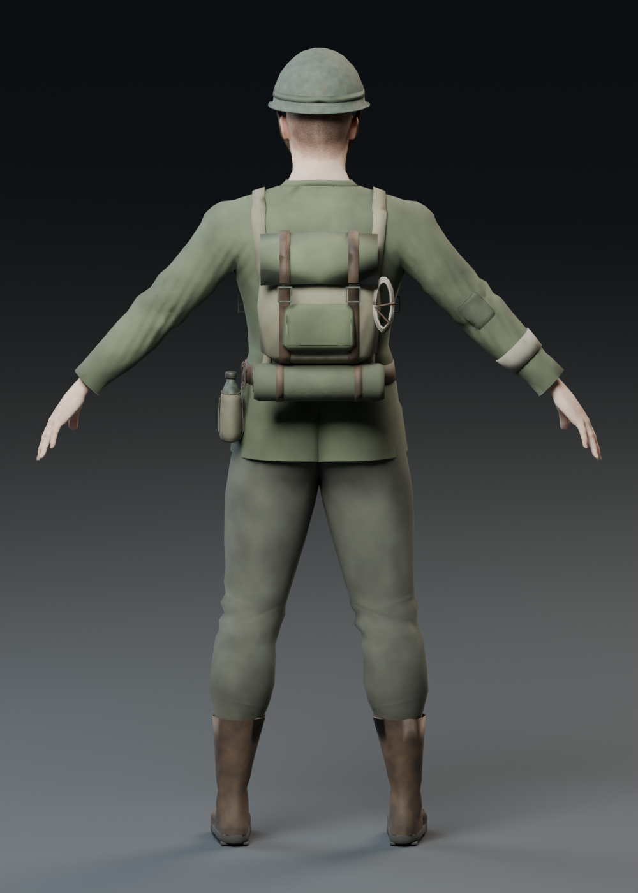

# Soldado raso v2 — Vigías del Umbral

Personaje de una facción militar ficticia, con uniforme inspirado en la Segunda Guerra Mundial y desgaste postapocalíptico moderado.

## Entrega actual

La carpeta `entrega_final/` contiene el refinamiento verificado tras las nueve fases.

- **[Abrir en Blender](entrega_final/Vigias_del_Umbral.blend)**: personaje editable, rig, biblioteca interna, cámaras y texturas empaquetadas.
- [GLB con rig y texturas](entrega_final/Vigias_del_Umbral.glb).
- [Biblioteca de accesorios](entrega_final/Biblioteca_Umbral.blend): 29 maestros y tres conjuntos reutilizables, sin depender del personaje.
- [Informe final](entrega_final/INFORME_FINAL.md), [comprobación de requisitos](entrega_final/MATRIZ_REQUISITOS.md) y [auditoría del nativo](entrega_final/auditoria_nativo.json).

12.964 vértices, 24.674 triángulos, 46 mallas, cinco materiales, 14 mapas y 52 huesos. Hay 25 anclajes. Rig FK básico, sin IK, controles faciales ni ciclos terminados. Se revisaron nueve imágenes estáticas y siete posturas de flexión.

La geometría queda un 23,37 % por encima del extremo orientativo de 20.000 triángulos. Se conservan rostro, dedos, articulaciones y equipo reutilizable completo; la reducción y su justificación están en el informe. La entrega incluye un único nivel de detalle.

Abrir el `.blend` y pulsar F12 para renderizar el cuerpo completo. Las cámaras `FINAL` incluyen frontal, posterior, lateral, tres cuartos, rostro y detalles. El [informe](entrega_final/INFORME_FINAL.md) explica cómo activarlas y reutilizar accesorios.

## Versiones anteriores

- [Ceniza_Modular_v2.blend](soldado_raso_v2/Ceniza_Modular_v2.blend), [GLB v2](soldado_raso_v2/Ceniza_Modular_v2.glb) y [biblioteca v2](soldado_raso_v2/Biblioteca_Ceniza_v2.blend): corrección inicial de cantimplora y proporciones de botas, conservada como versión anterior.
- [Checkpoint de rig de fase 7](refinamiento_en_curso/07_Rig.blend): avance publicado antes de terminar las últimas fases. La entrega actual está en `entrega_final/`.

## Fuentes y verificación

Créditos de los assets de origen en [FUENTES_Y_LICENCIAS.md](FUENTES_Y_LICENCIAS.md) y texto de licencia en [LICENSE.ASSETS.md](LICENSE.ASSETS.md). La licencia conservada corresponde a los assets descritos en esos créditos.

[Revisión de imágenes finales](entrega_final/revision_visual.json), [pruebas de GLB](entrega_final/auditoria_glb.json) y [manifiesto SHA-256](manifest_sha256.json). Las auditorías históricas de `validacion/` describen sus respectivos puntos de control; los renders de la entrega actual están en `entrega_final/renders/` y `entrega_final/poses/`.
