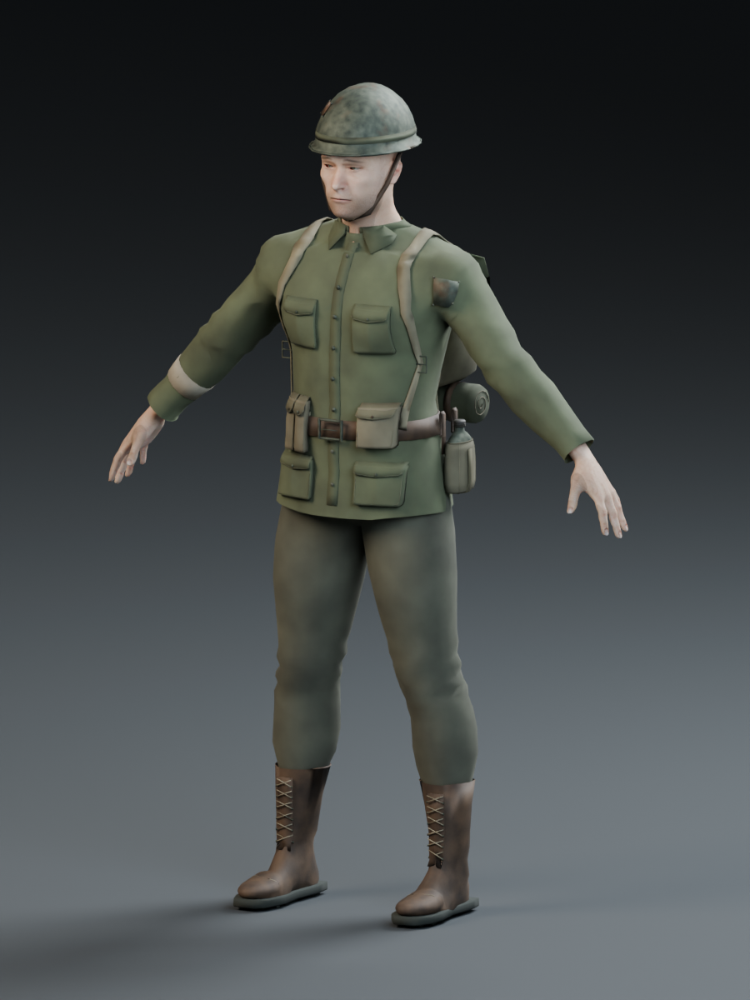
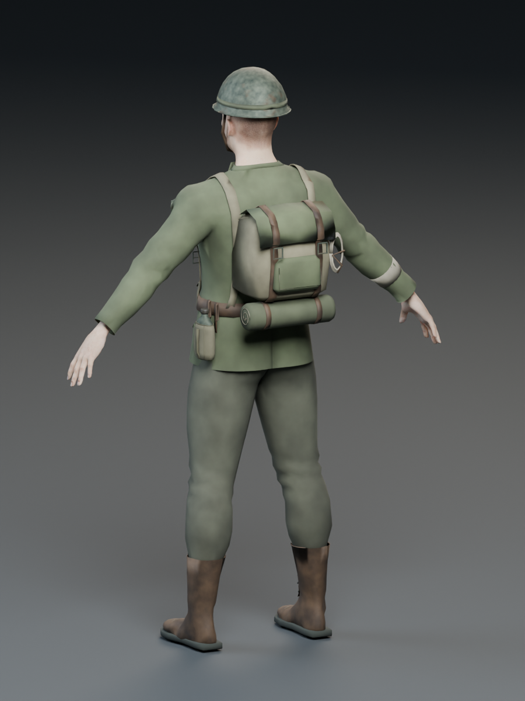

# Soldado raso v2

Personaje militar de una facción ficticia, preparado en Blender con equipamiento modular y un rig humanoide básico.

## Versión v2

Abre **[Ceniza_Modular_v2.blend](soldado_raso_v2/Ceniza_Modular_v2.blend)** en Blender. Incluye las correcciones de cantimplora y botas: la cantimplora tiene funda y trabillas al cinturón, y las botas tienen proporciones más ajustadas.

- [Ceniza_Modular_v2.glb](soldado_raso_v2/Ceniza_Modular_v2.glb): exportación con texturas embebidas y rig.
- [Biblioteca_Ceniza_v2.blend](soldado_raso_v2/Biblioteca_Ceniza_v2.blend): 23 accesorios reutilizables.
- 12.870 vértices, 24.621 triángulos, 44 mallas, cinco materiales y 52 huesos.
- Las texturas están empaquetadas en los archivos Blender.

## Refinamiento en curso

[07_Rig.blend](refinamiento_en_curso/07_Rig.blend) es el avance más reciente del refinamiento: rostro, uniforme, desgaste, botas, biblioteca modular y ajustes del rig. Se conserva como un punto de control de trabajo; la revisión de la fase 7 y las fases 8 y 9 siguen pendientes.

- [Biblioteca_Umbral.blend](refinamiento_en_curso/Biblioteca_Umbral.blend): 29 piezas maestras y tres conjuntos reutilizables, con catálogos de Blender.
- 13.523 vértices, 25.792 triángulos, 46 mallas del personaje, cinco materiales y 52 huesos. Los maestros y vistas de biblioteca no se suman a estas cifras.
- Rig FK básico, sin ciclos terminados de caminar o correr. Las imágenes de poses son pruebas de deformación.
- Texturas empaquetadas. Las fases pendientes incluyen la evaluación final de materiales y presupuesto de triángulos y las pruebas de entrega.
- [Mapa humanoide](refinamiento_en_curso/humanoide.json) y [catálogo de accesorios](refinamiento_en_curso/catalogo.json).

Para reutilizar accesorios, usa el navegador de assets o `File > Append`. Para exportar el personaje refinado, incluye su colección `CENIZA | Modular`, con mallas, rig y anclajes; excluye `MODULAR_LIBRARY` y las escenas de catálogo.

## Fuentes y comprobaciones

Los créditos y licencias de los assets de origen están en [FUENTES_Y_LICENCIAS.md](FUENTES_Y_LICENCIAS.md) y [LICENSE.ASSETS.md](LICENSE.ASSETS.md). El archivo de licencia corresponde a los assets de origen descritos en los créditos.

[verificacion_publicacion.json](verificacion_publicacion.json) registra la apertura de los nativos y el empaquetado de imágenes. [manifest_sha256.json](manifest_sha256.json) permite comprobar la integridad de los archivos publicados.
